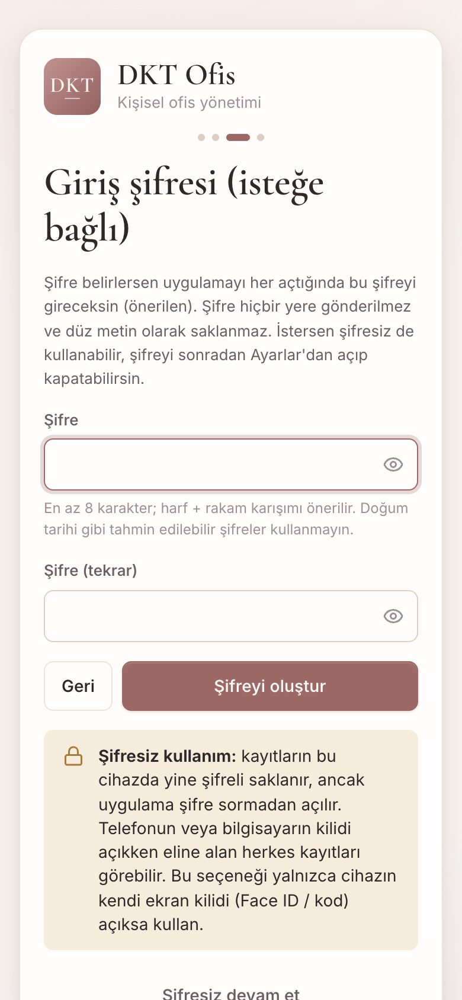
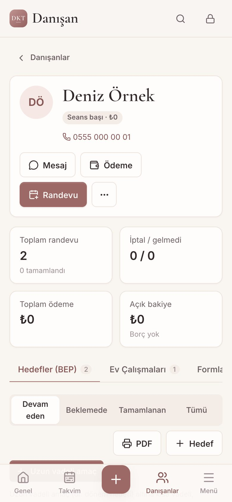
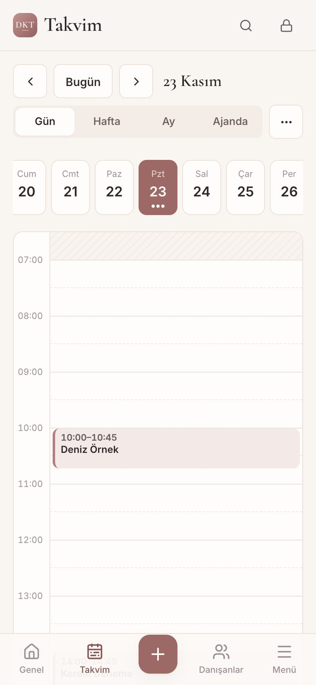
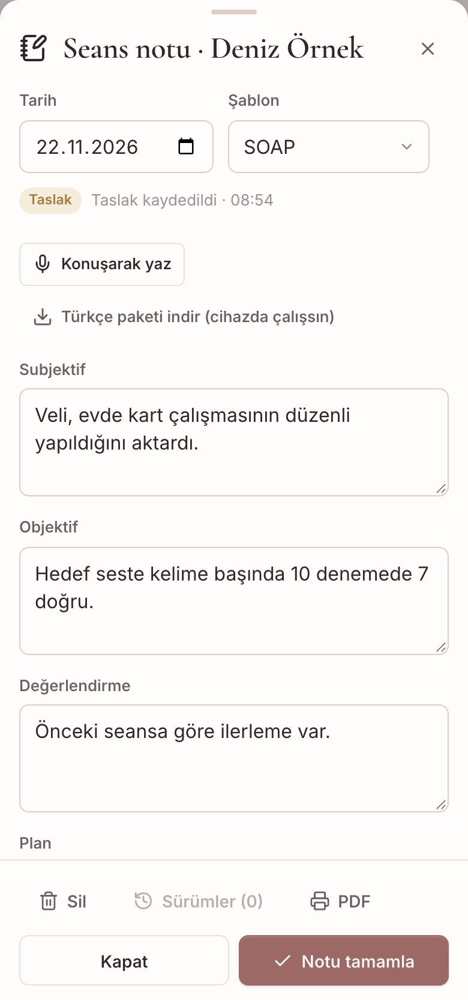
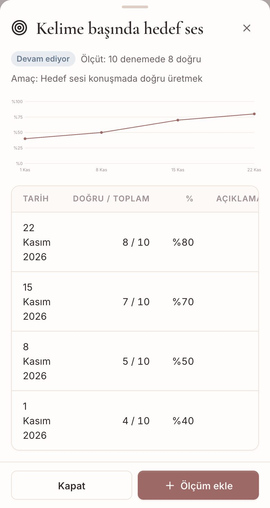
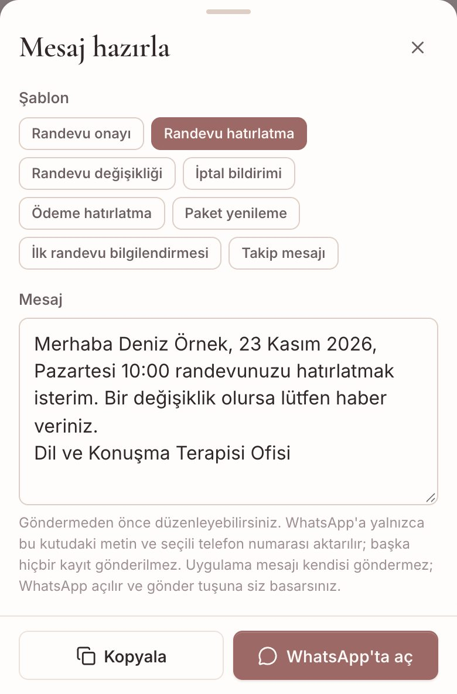
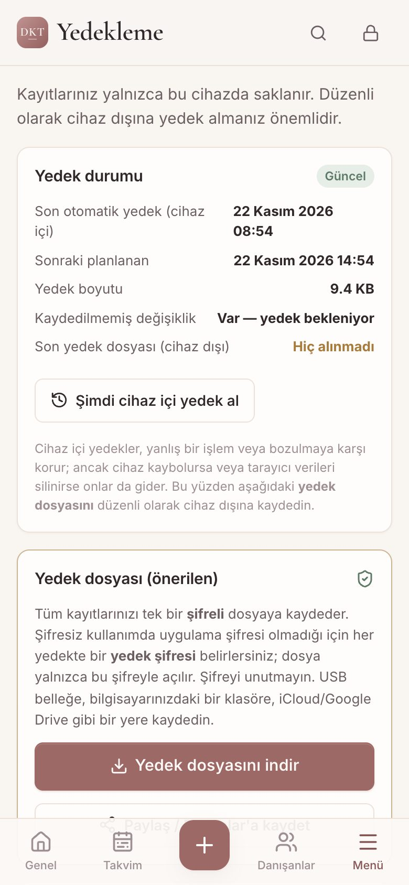

# 🩺 DKT Ofis · Kullanım Kılavuzu

> Danışan, randevu, seans notu, ödeme ve rapor işleriniz tek yerde.
> Kayıtlar **yalnızca sizin cihazınızda, şifreli** durur.
>
> 🌐 **Adres:** https://dkt-ofis.terapiofisi.workers.dev · 📄 Yazdırılabilir renkli sürüm: [`KULLANIM-KILAVUZU.pdf`](KULLANIM-KILAVUZU.pdf)

| ➕ Bir şey eklemek | 🔎 Aramak | ❓ Takıldığınızda |
|---|---|---|
| Altta / üstte **+ Yeni** | Üstteki **Ara** (bilgisayarda Ctrl + K) | **Menü → Yardım Merkezi** |

---

## 1️⃣ Başlarken

### 🚀 İlk açılış
1. Adresi açın → **Başlayalım** → adınız → **Devam**.
2. Şifre ekranında seçin: **Şifreyi oluştur** (önerilen) ya da **Şifresiz devam et**.
3. Şifre seçtiyseniz **kurtarma kodunu** kâğıda yazıp saklayın.

> [!TIP]
> Şifreyi sonradan **Ayarlar → Güvenlik**'ten açıp kapatabilirsiniz. Kayıtlarınız silinmez.

### 📱 Telefona ve bilgisayara ekleme

| Cihaz | Nasıl? |
|---|---|
| **iPhone** | **Safari** → **Paylaş** → **Ana Ekrana Ekle** → *Web Uygulaması olarak aç* açık → **Ekle** |
| **Android** | **Chrome** → **⋮** → **Uygulamayı yükle** |
| **Bilgisayar** | Chrome / Edge: adres çubuğundaki **yükle** simgesi · Mac Safari: **Dosya → Dock'a Ekle** |

> [!NOTE]
> Uygulamayı hep ana ekrandaki **DKT Ofis** simgesinden açın. Telefondaki ve bilgisayardaki kayıtlar ayrıdır; aktarmak için 💾 Yedek bölümüne bakın.

 

---

## 2️⃣ Günlük iş ve ödemeler

### 👤 Danışanlar
📍 **Danışanlar → Yeni danışan**
- Ad soyad yazmanız yeterli. Telefon numarası WhatsApp mesajları için kullanılır.
- **Düzenlemek:** danışan dosyası → **⋯** → **Bilgileri düzenle**
- **Artık gelmeyen danışan:** **⋯** → **Arşivle**. Hiçbir kayıt silinmez.

### 🗂️ Danışan dosyası
Danışanın adına dokunun. Sekmeler: **Genel Bakış · Randevular · Seans Notları · Hedefler (BEP) · Ev Çalışmaları · Formlar · Belgeler · Zaman Çizelgesi · Ödemeler · Paketler**

> [!TIP]
> **Zaman Çizelgesi** seansları, notları, ölçümleri, ödevleri ve ödemeleri tarih sırasıyla tek listede gösterir.

 

### 📅 Takvim ve randevu
📍 **Takvim** · **+ Yeni → Randevu**
- **Oluşturmak:** Boş bir saate dokunun, danışanı ve saati seçin. Tekrarlayan randevu için **Tekrar** bölümünü kullanın.
- **Değiştirmek:** Randevuya dokunun → **Düzenle** ya da **Taşı / Ertele**.
- **İptal / gelmedi:** **İptal et** · **Gelmedi**
- **Görünümler:** **Gün · Hafta · Ay · Ajanda**

 

### 🕖 Çalışma saatleri
📍 **Ayarlar → Çalışma saatleri ve müsaitlik**

Haftanın **7 günü 07.00–21.00** açıktır. Boş saat önerileri, çakışma uyarıları ve tekrarlayan randevular bu saatlere göre çalışır.
- Her günün saatini ayrı ayrı değiştirebilirsiniz. Günün yanındaki kutuyu kaldırırsanız o gün kapalı olur.
- **Tüm açık günlere uygula** bir günün saatini diğer açık günlere kopyalar. **Haftanın 7 günü 07:00–21:00** standart düzeni geri getirir. Bitirince **Çalışma saatlerini kaydet**'e basın.

> [!NOTE]
> Çalışma saati dışındaki bir randevu engellenmez, yalnızca uyarı çıkar. Tatil veya izin için **Zaman kapat**'ı kullanın.

### ⏳ Bekleme listesi ve boş saat bulma
📍 **Menü → Bekleme Listesi**
- Bekleyen kişiyi, uygun olduğu gün ve saati yazın.
- Takvimde boş saat açılınca **Genel Bakış**'ta uygun kişiler önerilir → **Eşleştir**.
- Randevu formu da **önerilen boş saatleri** gösterir; birine dokunmanız yeterli.

### 💳 Ödeme, borç ve paket
- **Ödeme almak:** **+ Yeni → Ödeme**. Kısmi ödemede alınan tutarı yazmanız yeterli.
- **Borçlar:** **Ödemeler → Açık alacaklar** sekmesi. Danışanın Genel Bakış bölümünde de görünür.
- **Paket satmak:** **Menü → Paketler → Yeni paket**. Pakete bağlı her seans tamamlandığında paketten 1 seans düşer.

### 📊 Gelir, gider ve raporlar
- **Gider eklemek:** **+ Yeni → Gider**. Her ay tekrarlayan giderler için **Gelir-Gider → Düzenli giderler**.
- **Raporlar:** Tahsilat, gider, katılım oranı ve **iptallerden kaybedilen gelir**.
- **Hızlı özet:** **Genel Bakış**'taki **Bu hafta / Bu ay** kartı.

---

## 3️⃣ Seans notu, hedef ve ödev

### 📝 Seans tamamlama ve seans notu
📍 **Bugün → Seans notu** · **Danışan → Seans Notları**
1. Seans bitince **Bugün** ekranında **Tamamlandı**'ya basın ve ödeme alındıysa işaretleyin. Not yazmak için **Kaydettikten sonra seans notu yaz** kutusunu işaretleyin.
2. Şablon seçin: **Serbest not · SOAP · Kısa seans notu**. Kendi şablonunuzu **Menü → Not ve Form Şablonları**'nda hazırlayabilirsiniz.
3. Siz yazdıkça not **otomatik taslak** olarak kaydedilir. Bitince **Notu tamamla**'ya basın.
4. Eski hâller **Sürümler**'de saklanır. Silinen notlar **Silinenler**'den geri alınır.

 

### 🎙️ Konuşarak not yazma
1. Seans notunda **Konuşarak yaz**'a basın ve konuşun. Söyledikleriniz imlecin olduğu yere eklenir.
2. Noktalama için “virgül”, “nokta”, “soru işareti” ya da “yeni satır” deyin.
3. Bitince **Dinlemeyi durdur**'a basın. Metni okuyup düzeltin, sonra kaydedin.

> [!WARNING]
> Yanında **“Ses cihazda işlenir”** yazmıyorsa ses, metne çevrilmek için Apple, Google veya Microsoft'a gidebilir; ilk kullanımda size sorulur. Danışan adını ve tanısını sesli söylemeyin. Uygulama ses kaydı saklamaz.

### 🎯 BEP ve gelişim takibi
📍 **Danışan → Hedefler (BEP)**
1. **Uzun vadeli amaç** ekleyin. Altına **Bu amaca hedef ekle** ile kısa vadeli hedefi ve ölçütünü yazın.
2. **Ölçüm**'e basıp doğru ve toplam deneme sayısını girin; yüzde kendiliğinden hesaplanır.
3. **Gelişim** grafiği ve tüm ölçümleri gösterir. Hedefin durumunu **devam ediyor**, **beklemede** veya **tamamlandı** olarak işaretleyin.

> [!TIP]
> Ölçümü seans notunun içinden de girebilirsiniz.

 

### 🏠 Ev çalışmaları ve formlar
📍 **Danışan → Ev Çalışmaları → Ev çalışması**
- Başlığı, açıklamayı ve son tarihi yazın. İsterseniz ilgili hedefi seçin.
- Sonraki seansta **Tamamlandı** veya **Tamamlanmadı** olarak işaretleyin. Süresi geçenler **Gecikti** olarak görünür. Eskileri görmek için **Tümü (geçmiş dahil)**'i seçin.
- 📋 Kendi değerlendirme formlarınızı **Not ve Form Şablonları**'nda hazırlayın, danışan dosyasındaki **Formlar** sekmesinden doldurun.

---

## 4️⃣ İletişim, hatırlatma, rapor ve yedek

### 💬 WhatsApp mesajı
📍 **Randevu → Hatırlat** · **Danışan → Mesaj**
1. Şablonu seçin ve metni gerekirse düzeltin.
2. **WhatsApp'ta aç**'a basın. WhatsApp, mesaj yazılmış hâlde açılır.
3. **Gönder tuşuna siz basarsınız.**

> [!WARNING]
> Uygulama hiçbir mesajı kendiliğinden göndermez. Mesaja tanı, sağlık bilgisi veya seans notu yazmayın.

 

### 🔔 Hatırlatma ve bildirim

| Kime? | Nasıl çalışır? |
|---|---|
| **Danışana** | Randevu formundaki **Danışana hatırlatma (WhatsApp)** ile ayarlanır. Zamanı gelenler **Genel Bakış**'ta listelenir; mesajı siz gönderirsiniz. |
| **Size** | **Ayarlar → Bildirimler** bölümünde zamanı seçin (ör. 1 gün, 2 saat önce), sonra **Cihaz bildirimlerine izin ver**'e dokunun. |

> [!NOTE]
> Bildirimler **uygulama açıkken** gelir. Uygulama kapalıyken de hatırlatma istiyorsanız **Önümüzdeki 60 günü telefon takvimine aktar**'a basın; telefonun takvimi kendi alarmını verir. Randevu değişirse takvime yeniden aktarın.

### 📄 PDF, CSV ve belgeler

| İstediğiniz | Nereden? |
|---|---|
| Tek seans notu | Seans notu penceresinde **PDF** |
| Tüm notlar / hedef raporu | Danışan → **Seans Notları** veya **Hedefler (BEP)** → **PDF** |
| Tam danışan dosyası | Danışan → **⋯** → **Danışan dosyası (PDF)** |
| Gelir-gider | **Raporlar → Gelir-gider PDF** |
| Excel'de açılan liste (CSV) | **Yedekleme → CSV olarak dışa aktar** |
| Fotoğraf / belge eklemek | Danışan → **Belgeler → Dosya ekle** (en fazla 10 MB) |

PDF almak için açılan sayfada **PDF olarak kaydet / yazdır**'a basın ve yazdırma penceresinde **PDF olarak kaydet**'i seçin.

> [!WARNING]
> PDF ve CSV dosyaları şifresizdir. Güvenli bir yerde saklayın ve paylaşmayın.

### 💾 Yedek ve internetsiz kullanım
📍 **Menü → Yedekleme**
1. **Yedek dosyasını indir**'e basın (telefonda **Paylaş / Dosyalar'a kaydet**). Dosyayı iCloud, Google Drive veya USB belleğe kaydedin. **Haftada bir** yedek alın.
2. **Geri yüklemek veya başka cihaza taşımak için:** Önce hedef cihazın kendi yedeğini alın. Ardından **Yedek dosyası seç** ile dosyayı seçin ve **Tamamen değiştir** ya da **Birleştir**'i seçin.

> [!TIP]
> Uygulama bir kez açıldıktan sonra internet olmadan da çalışır. Yalnızca WhatsApp mesajı için internet gerekir.

 

### 🔒 Gizlilik ve güvenlik
- Kayıtlar **yalnızca bu cihazda, şifreli** durur. Hiçbir sunucuya veya yapay zekâ servisine gönderilmez.
- Uygulama kameraya, konuma ve rehbere erişmez. Mikrofonu yalnızca siz **Konuşarak yaz**'a bastığınızda kullanır.
- Danışan bilgileri için **şifreli kullanımı** ve telefonun ekran kilidini öneririz. Şifre ve kurtarma kodu birlikte kaybolursa kayıtları yalnızca yedek dosyası kurtarabilir.
- Gerçek danışan verisi girmeden önce KVKK ve meslek kuralları açısından bir avukat veya veri koruma danışmanından görüş alın.

---

Ekran görüntüleri hayali örnek verilerle alınmıştır. Daha ayrıntılı adımlar için uygulamada **Menü → Yardım Merkezi**'ne bakın.
